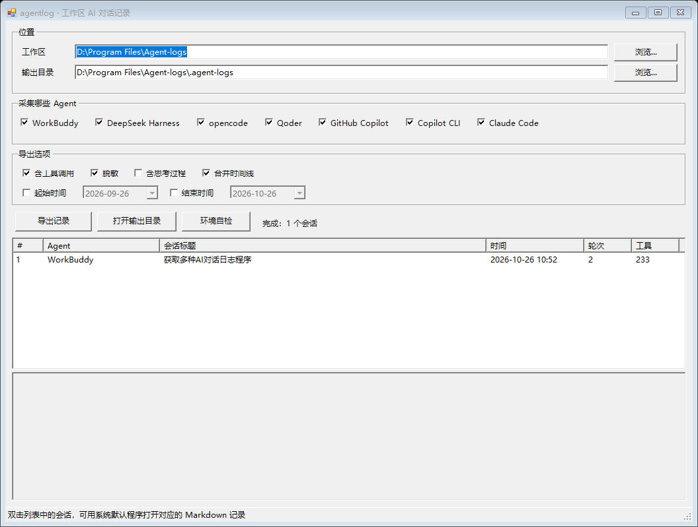

# agentlog

把**某个工作区（文件夹）**里、你与各种 AI Agent 的对话日志一键导出成可读的 Markdown 和结构化 JSON。

给需要提交「vibe coding 交互记录」的作业用：不用再手动截图、复制粘贴、拼时间线。

三种用法，同一套采集引擎：

```powershell
# ① 独立可执行程序（无需安装 Node.js，双击即可打开图形界面）
agentlog.exe

# ② 图形界面（Windows 原生窗口，双击 agentlog-gui.cmd 也可以）
powershell -ExecutionPolicy Bypass -File agentlog-gui.ps1

# ③ 命令行
node agentlog.mjs .
```



跑完在工作区下得到 `.agent-logs/`：

```
.agent-logs/
├── index.md            汇总：按 Agent 统计 + 会话清单 + 数据来源
├── timeline.md         跨 Agent 合并时间线（按时间排序）
├── transcripts/        每个会话一份完整记录
│   ├── 01-copilot-2026-09-16-输出乱码原因.md
│   └── 02-workbuddy-2026-09-21-3DES实现.md
├── sessions.json       结构化数据（完整消息 + 工具调用，便于二次处理）
└── manifest.json       本次导出参数与命中文件清单
```

---

## 独立可执行程序（agentlog.exe）

不想装 Node.js 的话，用单文件可执行程序：

1. 到 [Releases](../../releases) 下载 `agentlog-v1.0.0-windows-x64.zip`，解压得到 `agentlog.exe`；
2. **双击 `agentlog.exe`** —— 不带参数运行会自动弹出 Windows 原生图形界面；
3. 命令行用法与 `node agentlog.mjs` 完全一致，只是不用写 `node` 和脚本名：

```powershell
agentlog.exe .                       # 导出当前目录
agentlog.exe "D:/my project" -o ./记录 --redact
agentlog.exe . --list
agentlog.exe --gui                   # 显式打开图形界面
```

`agentlog.exe` 用 Node.js 自带的 SEA（Single Executable Application）机制打包：采集引擎和 PowerShell 界面脚本都嵌在二进制里，运行时只依赖 Windows 自带的 .NET Framework（界面）与 PowerShell 5.1，不联网、不写注册表、不装任何东西。体积约 83 MB（内含完整 Node 运行时）。

### 自己构建

```bash
node build-exe.mjs                 # 产出 dist/agentlog.exe
node build-exe.mjs --out <目录>     # 指定输出目录
node build-exe.mjs --keep          # 保留中间产物便于排查
```

要求 Node.js >= 22.5。构建时会用到 [postject](https://www.npmjs.com/package/postject) 把 blob 注入二进制；本机没有的话脚本会自动装到 `.build/` 目录，不会写进项目依赖。也可以用环境变量 `POSTJECT_CLI` 指定已有的 `postject/dist/cli.js` 路径。

构建过程做了五件事：ESM 转 CommonJS（SEA 入口只支持 CJS）→ 追加图形界面启动引导 → 生成 blob → 复制 Node 运行时并注入 → 跑一遍 `--version` 冒烟测试。

---

## 图形界面（Windows 原生）

`agentlog-gui.ps1` 是一个单文件的 Windows 桌面窗口，**只用 Windows 自带组件**：

| 部件 | 用的东西 |
| --- | --- |
| 窗口与控件 | `System.Windows.Forms`（Windows 自带 .NET Framework，底层即 User32 / ComCtl32 原生控件） |
| 选择文件夹 | Shell 原生 `FolderBrowserDialog` |
| 打开记录 / 输出目录 | ShellExecute，交给资源管理器默认关联程序 |
| 设置持久化 | `%APPDATA%\agentlog\gui-settings.json` |
| 采集 | 调用同目录的 `agentlog.mjs`（复用同一引擎，界面不含解析逻辑） |

不引入浏览器内核、Electron、Qt 或任何第三方 UI 库，也不需要 `npm install`。

界面能做的事：

- 选工作区 → 自动带出输出目录（也可另存）
- 勾选要采集哪些 Agent（7 个全支持）
- 选项：含工具调用 / 脱敏 / 含思考过程 / 合并时间线 / 起止时间
- 点「导出记录」后，下方列表直接列出会话（Agent、标题、时间、轮次、工具次数），**双击即可用系统默认程序打开该会话的 Markdown**
- 「环境自检」会检查 Node、各 Agent 日志目录是否就位
- 日志区实时显示导出过程，并给出**等价的命令行**，便于写进报告

无人值守的验证入口（也可用于自测）：

```powershell
powershell -ExecutionPolicy Bypass -File agentlog-gui.ps1 -SelfTest          # 环境自检
powershell -ExecutionPolicy Bypass -File agentlog-gui.ps1 -SmokeTest         # 只构建界面，不开窗
powershell -ExecutionPolicy Bypass -File agentlog-gui.ps1 -Export "D:\proj"  # 无界面导出
```

> 界面按字体实际像素比例换算所有尺寸，因此在 100% / 150% / 200% 缩放下布局一致；同时限制窗口不超过屏幕工作区。

---

## 支持的 Agent

| Agent | 读取位置 | 原始格式 | 状态 |
| --- | --- | --- | --- |
| **WorkBuddy** | `~/.workbuddy/projects/<项目>/<sessionId>.jsonl` | JSONL | 已验证 |
| **DeepSeek Harness** | `~/.dsh/sessions/<项目>/session-<id>/session.v4.jsonl.zstd` | 多帧 zstd 压缩 JSONL | 已验证 |
| **opencode** | `~/.local/share/opencode/opencode.db`（Windows 亦查 `%LOCALAPPDATA%`） | SQLite | 已验证 |
| **Qoder** | `~/.qoder/projects/<项目>/*.jsonl` | JSONL（Claude 风格） | 已验证 |
| **GitHub Copilot** | `<AppData>/<Code>/User/workspaceStorage/<hash>/chatSessions/*.jsonl` | 快照 + 增量 patch | 已验证 |
| **GitHub Copilot CLI** | `~/.copilot/session-state/<id>/events.jsonl` | 事件流 JSONL | 已验证 |
| **Claude Code**（附加） | `~/.claude/projects/<项目>/*.jsonl` | JSONL（Claude 风格） | 已验证 |

> 前五个是需求里点名要的，Claude Code 顺手加了一个（格式与 Qoder 同源）。

各 Agent 的存储格式差异很大，这个工具做的事情主要是三件：**找到文件 → 把不同格式统一成「用户 / 助手 / 工具调用」三种条目 → 按时间渲染成 Markdown**。

几个实际的坑，都已经处理：

- **DeepSeek Harness** 的会话是**多帧 zstd 追加写**的假 JSONL，标准解压器只解第一帧，需要按帧头切分逐帧解压；
- **opencode** 把会话存在 SQLite 里，且运行时处于 WAL 模式，直接读会撞锁，先拷贝快照再读；
- **GitHub Copilot** 新版日志是「一次全量快照 + 若干增量 patch」，其中 `requests` 数组是**追加语义**、流式正文是**带下标的续写语义**，猜错会丢一半对话；
- **WorkBuddy / Qoder** 会把 `<system-reminder>`、`<user_info>` 这类系统注入块拼进用户消息里，导出时会剥掉，只留你真正打的那句话；
- **DeepSeek Harness** 还会把「审批结果」「运行时上下文」「技能清单」也记成用户消息，会按 `source.kind` 过滤掉，否则时间线全是噪音；
- 路径匹配统一处理了大小写、正反斜杠、`file:///d%3A/...` 百分号编码，以及远程开发（`vscode-remote://`）路径。

---

## 快速开始

### 环境要求

| 用法 | 需要什么 |
| --- | --- |
| `agentlog.exe` | 只要 Windows 10/11（运行时已内置，界面用系统自带的 .NET Framework 与 PowerShell 5.1） |
| `agentlog-gui.ps1` | Windows PowerShell 5.1（系统自带）+ **Node.js >= 22.5** |
| `agentlog.mjs` | **Node.js >= 22.5**（用到内置 `node:sqlite` 读 opencode；zstd 解码需 >= 22.15，更低版本会自动回退到系统 `zstd` 命令） |

macOS / Linux 只能用命令行版（`agentlog.mjs`），且部分 Agent 的存储路径是 Windows 专属的。三种用法都没有第三方依赖，不用 `npm install`。

先自检一下环境：

```bash
node agentlog.mjs --self-test                       # 命令行
powershell -File agentlog-gui.ps1 -SelfTest         # 图形界面
```

会打印每个 Agent 的日志目录是否存在。Windows 上也可以直接双击 `agentlog.cmd`（命令行）或 `agentlog-gui.cmd`（图形界面）。

### 常用命令

```bash
# 导出当前目录的对话记录到 ./.agent-logs
node agentlog.mjs .

# 指定工作区和输出目录，并做脱敏（交作业推荐）
node agentlog.mjs "D:/my project" -o ./交互记录 --redact

# 先看看有什么，不写文件
node agentlog.mjs . --list

# 只要某几个 Agent、某段时间
node agentlog.mjs . --agents workbuddy,opencode --since 2026-10-20 --until 2026-10-26

# 连模型思考过程一起导出（会明显变长）
node agentlog.mjs . --reasoning
```

---

## 参数

| 参数 | 说明 |
| --- | --- |
| `[工作区目录]` | 要采集的工作区，省略则用当前目录 |
| `-o, --out <目录>` | 输出目录，默认 `<工作区>/.agent-logs` |
| `--agents <列表>` | 只导出指定 Agent，逗号分隔：`workbuddy,deepseek-harness,opencode,qoder,copilot,copilot-cli,claude-code` |
| `--since <日期>` | 只要该时间之后有消息的会话，支持 `2026-10-01` 或 `"2026-10-01 12:00"` |
| `--until <日期>` | 只要该时间之前有消息的会话 |
| `--redact` | 脱敏：邮箱、手机号、本机用户名路径（API Key / Token 始终自动打码） |
| `--no-tools` | 不输出工具调用细节，只保留对话 |
| `--reasoning` | 输出模型思考过程（默认关闭） |
| `--no-merge` | 不生成跨 Agent 合并时间线 |
| `--tool-output-chars <n>` | 工具结果截断长度，默认 1500 |
| `--list` | 只列出发现的会话，不写文件 |
| `--json-only` | 只输出 `sessions.json` |
| `--md-only` | 只输出 Markdown |
| `--self-test` | 检查运行环境与各存储目录 |
| `-h, --help` | 帮助 |

---

## 输出长什么样

单个会话（`transcripts/` 里每份的结构）：

```markdown
# 3DES文件加解密实现

- **Agent**：GitHub Copilot（Code）
- **会话 ID**：`4750abc7-...`
- **工作区**：`D:/计算机选修/信息安全`
- **开始时间**：2026-09-21 19:03:38
- **规模**：3 轮提问 / 5 条助手消息 / 12 次工具调用

## 第 1 轮

### 用户 · 19:03:38
请帮我实现 3DES 文件加解密 ...

### 助手 · 19:03:46
好的，先看一下现有代码结构 ...

#### 工具调用 · `copilot_readFile`
入参：{"file_path":"..."}
结果：...
```

- 默认**不包含**模型思考过程，交作业更清爽；需要时加 `--reasoning`。
- 工具调用单独成节，入参/结果都做了截断，避免几千行的 `ls` 输出淹没对话。
- 若某个会话本来就没有助手正文（只有思考与工具调用被持久化），会自动退回展示思考内容，不会导出空文档。

`timeline.md` 把所有 Agent 的提问与回答按时间排成一条线，适合展示「我在同一项目里换着用了几个工具」的过程。

---

## 交作业建议

1. 在项目根目录跑一次：
   ```bash
   node agentlog.mjs . --redact
   ```
2. 检查 `index.md` 里的数字对不对（会话数、轮次）。
3. 把整个 `.agent-logs/` 连同代码一起打包提交；只要文字的话，`timeline.md` + `transcripts/` 就够。
4. 提交前扫一眼有没有不该出现的邮箱、密钥（`--redact` 已处理大部分，但生成的绝对路径建议自己确认）。

---

## 已知限制

- **找不到会话**：最常见的原因是当时用另一种路径打开了项目（符号链接、不同盘符、`D:\a` 与 `D:/a` 之外的映射盘），或该工作区确实没用过这个 Agent。用 `--self-test` 看目录是否存在，用 `--list` 看已命中的文件。
- **Copilot 部分会话缺最终回复**：VS Code 只在特定时机把完整回复写入磁盘，被中断的会话可能只剩思考与工具调用。工具会如实导出已有内容，不会编造。
- **DeepSeek Harness 子会话**：同一任务可能产生多个并行会话，标题相同但属于不同会话，会分别导出。
- **Agent 升级改格式**：适配器都是按当前实测格式写的。如果哪天导不出来，先跑 `--self-test` 确认目录还在，再对照 `agentlog.mjs` 里对应的 `parseXxx` 函数调整字段。
- **只读不写**：工具不会修改任何 Agent 的原始日志，也不联网。

---

## 想加一个新 Agent？

在 `agentlog.mjs` 里加一个适配器即可，结构很简单：

```js
function collectMyAgent(ctx) {
  const sessions = [];
  for (const file of /* 找到会话文件 */) {
    const session = makeSession({ agent: 'my-agent', agentLabel: 'My Agent', source: file });
    session.cwd = /* 从文件里取工作区路径 */;
    pushEntry(session, { role: 'user', ts, text });
    pushEntry(session, { role: 'assistant', ts, text });
    pushEntry(session, { role: 'tool', ts, toolName, toolInput, toolOutput });
    if (isUnder(session.cwd, ctx.workspace)) sessions.push(session);
  }
  return { sessions, probes: [] };
}
```

然后把它注册到 `ADAPTERS` 数组里。渲染、脱敏、时间过滤、索引生成都是通用的，不用改。

---

## 仓库结构

```
agentlog.mjs          采集引擎（7 个 Agent 适配器 + 渲染 + 脱敏，单文件、零依赖）
agentlog-gui.ps1      Windows 原生图形界面（WinForms，单文件）
build-exe.mjs         打包脚本：产出单文件 agentlog.exe
agentlog.cmd          命令行启动器（自动找 Node）
agentlog-gui.cmd      图形界面启动器
.github/workflows     CI：在 windows-latest 上构建 exe 并上传产物
```

CI 会在每次推送时构建一次 exe 并把产物挂到 workflow run 上，方便拿最新版本而不用本地装 Node。

---

## 隐私

只读本地日志，不联网、不上传、不写注册表，也不会修改任何 Agent 的原始记录。脱敏（ `--redact` ）会处理邮箱、手机号、本机用户名路径，API Key / Token 则始终自动打码。

## 开源协议

[MIT](LICENSE)。
